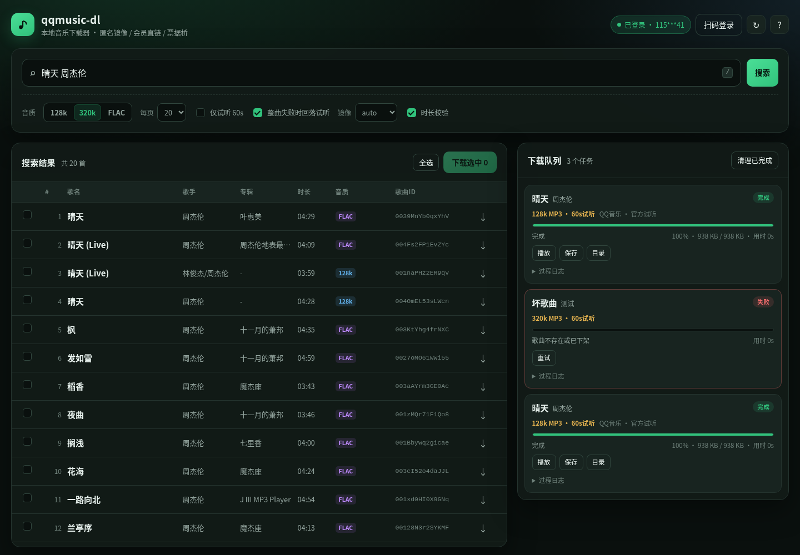

# qqmusic-dl

用 Rust 写的 QQ 音乐下载器，提供 **CLI / 全屏 TUI / 本地 WebUI** 三种界面。
三条取流通道：

| 通道 | 需要账号 | 音质 |
| --- | --- | --- |
| QQ 原生直链（vkey） | 免费曲目不需要；会员曲目需要 | 128k / 320k / FLAC |
| 匿名镜像（咪咕 / 酷我 / 网易） | **完全不需要** | 128k MP3 整曲 |
| 会员票据桥（serve / --bridge） | 签发端需要，下载端不需要 | 320k / FLAC |

- **匿名可用**：免费曲目走 QQ 直链；QQ 判定 VIP 的曲目，自动切匿名镜像取整曲 MP3
- **整曲校验**：下载后自己解析 MP3/FLAC/M4A 帧算时长，和 QQ 的 interval 对不上就删文件报错
- **版本防串**：原曲带「伴奏 / Live / 翻唱 / DJ / KTV」等标记的候选一律淘汰
- **票据桥**：会员账号只负责签发 bearer 直链（2 小时有效），其它机器零账号消费
- **扫码登录**：QQ / 微信 / QQ音乐 App 三种二维码登录，Cookie 自动落盘，不用手动复制
- **三种界面**：同一套取流引擎，CLI 适合脚本，TUI 适合终端，WebUI 适合浏览器；WebUI 是单文件内嵌前端，零构建、零 CDN、离线可用
- **断点续传更安全**：.part 记录音源/音质标记，换源不会错拼；同名文件更大时保留、更小时才升级覆盖（避免 128k 降级版毁掉已有 320k）
- **搜索双通道**：`search_for_qq_cp` 主用，旧 `client_search_cp` 自动兜底
- **清晰的终端 UI**：搜索结果直接带歌曲 ID，窄终端自适应布局，彩色状态提示（管道自动关闭颜色），每一步都有中文说明和失败建议

---

## 构建

    cargo build --release
    # 产物：./target/release/qqmusic-dl

---

## 使用

    # 搜索（结果表直接列出「歌曲ID」，复制即可下载）
    qqmusic-dl search "茉莉花" -n 5
    qqmusic-dl search "晴天 周杰伦" -n 3 --json

    # 按 songmid / 歌曲链接下载（默认 320k MP3）
    qqmusic-dl download 0048Ts0Q0oi3Ti -o ~/Music
    qqmusic-dl download "https://y.qq.com/n/ryqq/songDetail/0048Ts0Q0oi3Ti" -q flac

    # 搜索并下载第一首
    qqmusic-dl get "茉莉花 宋祖英" -n 1 -q 320 -o ~/Music

    # 纯匿名：不读任何 Cookie，QQ 拒绝就换匿名镜像
    qqmusic-dl --anon download 000Jd2XU1i8Dpj -o ~/Music

    # 指定镜像源（auto / migu / kuwo / netease / off）
    qqmusic-dl --anon download 0039MnYb0qxYhV --mirror migu -o ~/Music

    # 只看解析结果，不下载
    qqmusic-dl download 0048Ts0Q0oi3Ti --dry-run

    # 下载后直接播放（需要 ffplay 或 mpv）
    qqmusic-dl download 0048Ts0Q0oi3Ti --play

    # 试听 60 秒片段
    qqmusic-dl download 0039MnYb0qxYhV --preview -o ~/Music

    # 查看登录状态
    qqmusic-dl auth

    # 全屏 TUI（无子命令时，交互式终端也会直接进入）
    qqmusic-dl tui -o ~/Music -q 320

    # 本地 WebUI（默认 http://127.0.0.1:8088；--open 自动用浏览器打开）
    qqmusic-dl web --open
    qqmusic-dl --anon web -p 8088

    # TUI / WebUI 也可以消费会员票据桥（本机无需账号）
    qqmusic-dl --anon tui --bridge http://A:8080
    qqmusic-dl --anon web --bridge http://A:8080

### 全屏 TUI

`qqmusic-dl` 不带子命令时，在交互式终端里直接进入 TUI；也可以显式执行
`qqmusic-dl tui`。搜索、多选、下载队列、扫码登录都在一个界面里完成：

| 按键 | 作用 |
| --- | --- |
| `/` | 聚焦搜索框 |
| Enter | 搜索（输入框内）/ 下载光标歌曲（结果表） |
| Tab / Shift+Tab | 搜索 → 结果 → 队列 |
| Space / a | 选择当前歌曲 / 全选或取消全选 |
| d | 下载选中歌曲（没有选中则下载光标行） |
| ↑ ↓ j k / g G | 移动 / 跳到顶部或底部 |
| t | 切换音质 128 → 320 → FLAC |
| m | 切换匿名镜像 auto / migu / kuwo / netease / off |
| v | 切换「仅下载官方 60 秒试听」 |
| L / r | 扫码登录 / 刷新本地 Cookie 登录态 |
| o | 设置下载目录（支持 `~`） |
| p / x / c | 队列焦点下：播放已完成 / 取消任务 / 清理结束任务 |
| Enter（队列） | 任务详情；详情里 p 播放、o 打开所在目录 |
| ? / F1 | 快捷键帮助 |
| q / Ctrl+C | 退出（有未完成任务时 q 会二次确认） |

下载队列由单个后台 worker 串行处理，进度实时刷新；取消会保留 `.part`，
下次继续。`L` 登录会暂时退出备用屏，跑完现有扫码流程后按 Enter 回到界面。
退出、Ctrl+C、SIGTERM/SIGHUP 都会恢复光标、raw mode 和备用屏。

搜索框聚焦时，可打印字符优先作为关键词输入（所以 `q`/`t`/`m`/`v` 等全局键
需要先按 Tab 离开搜索框）。`?` 和 F1 在任何焦点下都能打开帮助。

### 本地 WebUI

    qqmusic-dl web                      # http://127.0.0.1:8088
    qqmusic-dl web --open               # 启动后自动打开浏览器
    qqmusic-dl web -p 9000 -o ~/Music -q flac
    qqmusic-dl --anon web               # 纯匿名模式（禁用扫码登录）

前端是编进二进制的单文件 HTML/CSS/JS，无 Node、无 npm、无 CDN、无外部字体，
断网也能打开界面（搜索/下载仍需要联网）。功能包括：

- 搜索、勾选多首、批量入队；音质 / 镜像 / 仅试听 / 时长校验可调
- 队列实时进度、速度、来源、耗时；取消、失败重试、清理已完成
- 浏览器内播放已完成文件（支持 Range 拖动进度条），也可保存到本地
- 一键在运行服务的机器上打开下载目录（调用 xdg-open / open）
- 扫码登录弹窗：QQ音乐 App / 微信 / QQ，二维码与状态实时展示
- 支持 `/?q=晴天%20周杰伦` 直接打开一次搜索，方便收藏本地链接

安全默认值：只监听 `127.0.0.1`；POST 必须是同源 `application/json`；
Host 只允许 localhost / IP 字面量（防 DNS rebinding）；文件接口只接受任务 id，
不接受任意路径。需要从别的机器访问时建议用 SSH 端口转发：

    ssh -L 8088:127.0.0.1:8088 user@运行web的机器

如果确实要监听局域网，`--bind 0.0.0.0` 会打印警告：能访问该端口的人都能使用
当前登录态搜索/下载。若服务用 `--cookie` 或 `QQMUSIC_COOKIE` 启动，显式 Cookie
优先级更高，WebUI 会禁用扫码登录；用 `--cookie-file` 启动时，登录成功后会把
Cookie 同步到该文件。

常用 HTTP 接口（调试 / 二次开发）：

| 方法 | 路径 | 说明 |
| --- | --- | --- |
| GET | /api/health | 版本、登录态、下载目录、默认音质 |
| GET | /api/search?q=&limit= | 搜索歌曲 |
| GET/POST | /api/jobs | 任务列表 / 批量创建任务 |
| GET | /api/jobs/:id | 单任务状态与日志 |
| POST | /api/jobs/:id/cancel | 取消任务 |
| GET | /api/jobs/:id/file[?download=1] | 音频流（Range）/ 下载 |
| POST | /api/login/start, /api/login/cancel | 启动 / 取消扫码登录 |
| GET | /api/login/status, /api/login/qr?kind= | 登录状态 / 二维码图片 |

### 扫码登录（可选）

    qqmusic-dl login wx        # 微信扫码
    qqmusic-dl login qq        # QQ 扫码
    qqmusic-dl login qqmusic   # QQ音乐 App 扫码（同一个码也支持手机 QQ / 微信）

终端里会直接把二维码画出来（半块字符渲染、行高按 2:1 折算、四周留静默区，手机能扫），
并给出 3～4 步中文操作提示；同时把服务端下发的原始图片存到
~/.cache/qqmusic-dl/qr-*.{png,jpg} 并用 xdg-open 打开。
扫完确认，Cookie 自动写入 ~/.config/qqmusic-dl/cookie.txt（权限 0600），
之后所有命令都不用再传 --cookie。用 `--cookie-file 自定义路径` 时，登录成功后
会把 Cookie 同步到该文件；`--cookie` 或 `QQMUSIC_COOKIE` 的优先级更高，
如果设置了它们，TUI / WebUI 会禁用扫码登录，CLI 登录后也会提示这一点。

`login qqmusic` 走的是 QQ音乐客户端同款链路：本地申请二维码后，通过
MQTT 5 over WebSocket 订阅 `management.qrcode_login/<qrcodeID>` 接收扫码状态，
再用手机端下发的临时票据换正式 musickey。二维码有效期约 15 分钟。

    --no-open     不自动打开二维码图片
    --timeout N   等待扫码的秒数（默认 180）

QR 图片格式：QQ 下发 1-bit PNG（111×111），微信下发 JPEG（470×470），
QQ音乐 App 下发 PNG data URL；程序按字节魔数判断，不信扩展名；
解不出来时仍会保存图片并给出路径。

### 会员账号（手动 Cookie，可选）

    python3 tools/firefox_cookie.py --export     # 直接从 Firefox 导出
    export QQMUSIC_COOKIE='qm_keyst=...; qqmusic_key=...; wxuin=...'
    qqmusic-dl auth
    qqmusic-dl download 000Jd2XU1i8Dpj -q flac -o ~/Music

Cookie 也可以放在 ~/.config/qqmusic-dl/cookie.txt，
或用 --cookie / --cookie-file 指定。

### 票据桥（把会员接口「匿名化」）

会员账号签出来的直链是 bearer token：不校验 Cookie，也不绑 IP，2 小时内谁拿到谁能下。
于是可以一台机器持号签发，其它机器完全匿名消费：

    # A 机（持有会员 Cookie）
    qqmusic-dl serve -p 8080

    # B 机（没有任何账号）
    qqmusic-dl --anon download 000Jd2XU1i8Dpj --bridge http://A:8080 -o ~/Music
    qqmusic-dl --anon get "恋曲1990 罗大佑" --bridge http://A:8080

    # 也可以只签发一条直链，贴到任何下载器
    qqmusic-dl mint 000Jd2XU1i8Dpj -q 320
    qqmusic-dl mint 000Jd2XU1i8Dpj -q flac --json

`serve` 默认监听 `0.0.0.0:8080`，供局域网里的其它机器消费；只想本机使用可加
`--bind 127.0.0.1`。注意：任何能访问该端口的人都能签发/使用直链，请只在可信网络开启。

---

## 音质

| 参数 | QQ 前缀 | 匿名镜像 |
| --- | --- | --- |
| -q 128 | M500 | 128k MP3 |
| -q 320（默认） | M800 | 128k MP3 |
| -q flac | F000 | 128k MP3 |

QQ 前缀映射经真实下载 + 帧解析校验。
匿名镜像只有 128k —— 咪咕 / 酷我 / 网易对匿名用户只放标准音质，
高清与无损要登录会员（咪咕 HQ 会直接返回「请升级客户端」）。

---

## 匿名能力边界（实测结论）

QQ 的取流接口 vkey.GetVkeyServer 只按 Cookie 判权限：
不带会员 Cookie 时，M500/M800/F000/C400 全部返回 result=104003、purl 为空，
CDN 直连无 vkey 一律 403，试听 vkey 换路径也 403。
**所以「QQ 服务器匿名发会员直链」这条路不存在**，客户端没有任何可伪造的开关。

工具的处理方式是：

1. 先用 QQ 原生接口（免费曲目直接整曲，最高 FLAC）；
2. 被拒绝时切匿名镜像（咪咕 / 酷我 / 网易），拿同一首歌在那边对匿名开放的 128k 整曲；
3. 镜像也没有时回落到 QQ 官方 60 秒试听。

镜像取到的不是 QQ 的音频，是同一首歌在其它平台的公开免费流；
跨平台匹配靠「曲名 + 歌手 + 版本标记 + 时长」四重校验，宁可不下载也不拿伴奏/翻唱冒充。

完整的抓包与逆向记录见 [docs/REVERSE-ENGINEERING.md](docs/REVERSE-ENGINEERING.md)。

---

## 模块

| 文件 | 职责 |
| --- | --- |
| src/api.rs | QQ 搜索（双接口兜底）/ 详情 / vkey 取流 |
| src/auth.rs | Cookie 解析、uin 归一化、g_tk（hash33） |
| src/mirror.rs | 匿名镜像：咪咕 / 酷我 / 网易 + 匹配打分 |
| src/bridge.rs | 票据桥：serve 端签发、client 端消费 |
| src/flow.rs | CLI/TUI/WebUI 共用的取流回退、下载与整曲校验流程 |
| src/login.rs | QQ / 微信扫码登录（二维码解码 + 终端渲染） |
| src/login/mobile.rs | QQ音乐 App 扫码登录（CreateQRCode + MQTT 5 over WSS） |
| src/tui.rs | 全屏 TUI（ratatui + crossterm） |
| src/web.rs | 本地 WebUI 服务（tiny_http）、任务队列、Range 音频、扫码登录子进程 |
| src/web/index.html | 内嵌单页前端（内联 CSS/JS，无外部资源） |
| src/web/favicon.svg | 内嵌站点图标 |
| src/ui.rs | 终端颜色与提示前缀（TTY / NO_COLOR 自适应） |
| src/util.rs | songmid 解析、文件名清洗、URL 编解码、打开/播放辅助 |
| src/probe.rs | 本地音频时长解析（MP3 / FLAC / M4A） |
| src/download.rs | 断点续传（带音源标记）、进度回调、取消、文件头校验 |
| tools/decrypt_ag1.js | 解密网页版 musics.fcg 的 ag-1 请求体 |
| tools/firefox_cookie.py | 从本机 Firefox profile 直接导出 QQ 音乐 Cookie |
| LICENSE | AGPL-3.0-or-later 全文 |

---

## 许可证

**AGPL-3.0-or-later** —— 全文见 [LICENSE](LICENSE)，SPDX 标识 `AGPL-3.0-or-later`
（GNU Affero GPL v3，或你选择的任何更新版本）。

按 AGPL 第 13 条：如果你修改本程序并作为网络服务提供给他人使用，
需要向这些使用者提供对应的完整源码。
